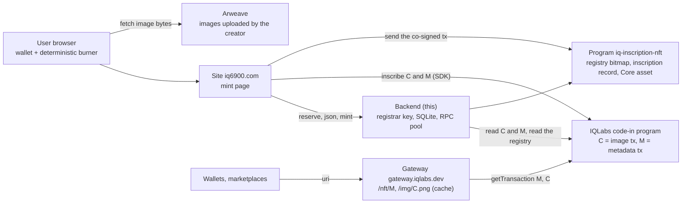
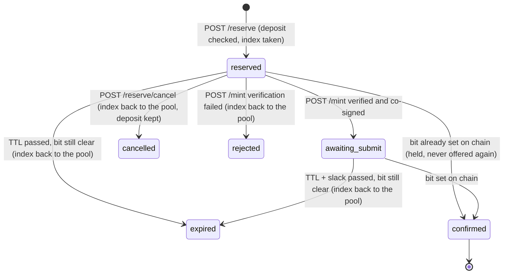
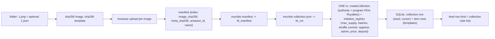

# Backend: reserve, verify, co-sign

The off-chain half of the inscription NFT mint. One Bun process serves every collection. It hands out item numbers, builds the canonical metadata, verifies that what the minter inscribed is the item it was given, and co-signs the `register_item` transaction with the registrar key. Nothing else can admit a token into a collection. The chain enforces the rest (one token per number, one token per inscription, price, collection membership); see the program in `../programs`.

Spec: [IQCoreTeam/iq6900 issue #11](https://github.com/IQCoreTeam/iq6900/issues/11). Why the mark lives on chain and how this differs from bible-nft: [the structure comment](https://github.com/IQCoreTeam/iq6900/issues/11#issuecomment-6230857399).

## Where it sits



The backend never pays for anything and never touches a user's funds. The burner (derived from one wallet signature, same as the site's inscription flow) is the fee payer for C, M and the mint; the backend only adds the registrar signature.

## What a mint looks like from the backend

```mermaid
sequenceDiagram
  participant BR as Burner (browser)
  participant B as Backend
  participant CH as Chain
  BR->>CH: deposit transfer burner -> creator treasury
  BR->>B: POST /c/:slug/reserve {wallet, burner, depositSig}
  B->>CH: getParsedTransaction(depositSig): burner -> treasury >= deposit, recent, unused
  B->>B: rules: window, allowlist, per-wallet limit, open reservations
  B->>B: next index from the returned queue, else the shuffle cursor
  B->>CH: registry bitmap: if that bit is set, hold it as confirmed and take the next
  B-->>BR: {reservationId, index, name, arweaveId, imageSha256, expiresAt}
  BR->>CH: inscribe the Arweave bytes as a feed row {kind image, body, who} -> C
  BR->>B: GET /c/:slug/json/:index?c=C
  B-->>BR: canonical JSON (template + image = gateway/img/C.png + attributes.inscription = C)
  BR->>CH: inscribe that exact string -> M
  BR->>B: POST /c/:slug/mint {reservationId, inscriptionSig C, metaSig M, asset}
  B->>CH: getTransaction(C): fee payer == burner, row.who == wallet, sha256(image bytes) == manifest
  B->>CH: getTransaction(M): fee payer == burner, bytes == canonical JSON
  B->>B: reservation -> awaiting_submit; build register_item; partialSign(registrar)
  B-->>BR: {transaction base64, lastValidBlockHeight}
  BR->>CH: partialSign(burner, asset); send
  CH->>CH: bit set, inscription record, price - deposit to creator, fee to platform, Core asset to wallet
  B->>CH: reaper / reconciler see the bit -> reservation confirmed, mirror row written
```

A second `POST /mint` for the same reservation is a replay: no new verification, a fresh blockhash on the same co-signed instruction. After the bit is set the same call answers `{status: "confirmed"}`.

## Reservation states



Only `reserved` and a dead `awaiting_submit` ever return an index to the pool. The deposit is never refunded by the backend; it went to the creator at reservation time.

## What the creator deploy does (CLI now, the site wizard later)



The collection and its registry are created in one transaction so nobody can initialize a registry for a fresh collection in between (`initialize_registry` is permissionless by design).

## HTTP API

| Route | Input | What it checks | Output |
|---|---|---|---|
| `GET /health` | | | cluster, program id |
| `GET /c` | | | every collection's public view |
| `GET /c/:slug` | | | public view + minted indices |
| `GET /c/:slug/items?offset&limit` | | | index, name, arweaveId, mime, minted (max 200 per page) |
| `POST /c/:slug/reserve` | `wallet`, `burner`, `depositSig` | pubkeys, rate limit per IP, window, allowlist, per-wallet limit, open reservations, deposit tx (burner -> treasury, amount, age, unused), registry bitmap | `reservationId`, `index`, `name`, `arweaveId`, `imageSha256`, `imageMime`, `expiresAt` |
| `POST /c/:slug/reserve/touch` | `reservationId` | state is `reserved` | new `expiresAt` |
| `POST /c/:slug/reserve/cancel` | `reservationId` | state is `reserved` | released |
| `GET /c/:slug/json/:index?c=C` | | index exists, C is a signature | the canonical metadata JSON, byte for byte what to inscribe |
| `POST /c/:slug/mint` | `reservationId`, `inscriptionSig`, `metaSig`, `asset` | reservation live and not expired; C: fee payer, `who`, image hash; M: fee payer, exact bytes | `transaction` (base64, registrar-signed), `lastValidBlockHeight`, `index`; or `replay: true`; or `status: confirmed` |
| `POST /single/mint` | `wallet`, `burner`, `inscriptionSig`, `metaSig`, `asset`, `name` | C: fee payer, `who`; M: fee payer, JSON, `attributes.inscription` = C | co-signed `register_single` tx |
| `GET /c/:slug/verify/:index` | | re-reads C and M from chain | manifest hash vs inscribed hash, metadata match, `matches` |
| `GET /c/:slug/recent` | | | latest mints from the mirror |
| `GET /stats` | | | reservation counts, RPC pool, last reconcile |

Errors are `{error, reason?}` with 400 (bad input, verification failed), 403 (rules), 404, 409 (sold out, expired, deposit reuse), 429 (limits).

## Environment

| Variable | Default | Meaning |
|---|---|---|
| `PORT` | 8787 | HTTP port |
| `CLUSTER` | devnet | label only (`devnet` / `mainnet`) |
| `DB_PATH` | backend/.data/nft.sqlite | the SQLite file. Holds the shuffle seeds and item templates: back it up, never commit it |
| `REGISTRAR_KEYPAIR` | backend/.registrar.json | the co-signer key. Never the fee payer. 0600, never in git. Rotatable on chain with `rotate_registrar` |
| `RPC_URLS` | https://api.devnet.solana.com | comma separated, primary first; endpoints we control (a hostile RPC could feed a doctored transaction to the verifier) |
| `GATEWAY_BASE` | https://gateway.iqlabs.dev | where the asset uri and the metadata image point |
| `SITE_BASE` | https://iq6900.com | collection external_url |
| `SINGLE_SLUG` | iq6900-inscriptions | the max_supply 0 registry that `/single/mint` uses |
| `RESERVATION_TTL_SECONDS` | 600 | hold length; the site re-arms it before inscribing |
| `REAPER_SLACK_SECONDS` | 60 | grace past TTL before the reaper acts |
| `DEPOSIT_MAX_AGE_SECONDS` | 900 | a deposit transfer older than this is refused |
| `RECONCILE_MS` / `REAPER_MS` | 300000 / 60000 | job cadence |
| `MAX_OPEN_RESERVATIONS_PER_WALLET` | 3 | |
| `RESERVE_PER_IP_PER_MINUTE` | 10 | |
| `CORS_ORIGIN` | * | the site origin in production |
| `ARWEAVE_KEYPAIR` | | SOL keypair that pays Irys uploads (deploy-collection only) |
| `IRYS_DEVNET` | true | Irys devnet node |
| `ARWEAVE_GATEWAY` | https://gateway.irys.xyz | where `arweave_id` resolves (devnet: https://devnet.irys.xyz) |

The program id comes from `../target/idl/iq_inscription_nft.json`. Copy `.env.example` to `.env` and run with `bun --env-file=backend/.env backend/src/server.ts` from the repo root.

## Database

| Table | Rows | Source of truth? |
|---|---|---|
| `collection` | one per collection: slug, Core collection, registry, name, symbol, creator, treasury, max_supply, price, deposit, sequential, **shuffle_seed** (secret until sellout), shuffle_commit, manifest_sig, manifest_hash, meta_sig, window, limits, **cursor** | yes, only here |
| `item` | one per item: index, name, image_sha256, mime, meta_sha256, arweave_id, **template** (name, description, attributes; no image) | yes (hashes are also in the inscribed manifest) |
| `allowlist` | (slug, wallet) | yes |
| `reservation` | one per reservation with its state, C, M, asset | yes |
| `returned` | indices back in the pool, served first | yes |
| `slot` | one per minted item: index, asset, owner, C, M | no, a mirror of the chain (registry bitmap + collection assets), rebuilt by the reconciler |

## Background jobs

- **Reaper** (every `REAPER_MS`): for reservations past TTL + slack, read the registry bitmap. Bit set: confirm. Bit clear: expire and return the index to the pool.
- **Reconciler** (every `RECONCILE_MS`, and at boot): per collection, read the bitmap (the sold set), confirm live reservations for sold indices, read the collection's assets from mpl-core and rewrite the `slot` mirror, and log a divergence if bitmap, `registry.minted`, asset count and mirror disagree.

## Files

| File | Role |
|---|---|
| `src/server.ts` | routes, rate limit, job startup |
| `src/allocator.ts` | eligibility, deposit check, index assignment |
| `src/reservations.ts` | state transitions |
| `src/verifier.ts` | C and M checks against the manifest and the canonical JSON |
| `src/cosigner.ts` | registrar-signed `register_item` / `register_single` |
| `src/metadata.ts` | the canonical JSON and the uri / image URL shapes |
| `src/program.ts` | PDAs, instruction builders, registry bitmap, collection asset scan |
| `src/collections.ts` | collection and item reads, permutation cache, slot mirror upsert |
| `src/shuffle.ts` | the pre-committed shuffle (byte-identical to bible-nft) |
| `src/reaper.ts`, `src/reconciler.ts` | jobs |
| `src/rpcpool.ts` | rotating RPC endpoints |
| `src/arweave.ts` | Irys upload |
| `src/feed.ts` | the iq6900 feed table identity (collection rows, item inscriptions) |
| `src/db.ts`, `src/config.ts` | schema, env |
| `scripts/deploy-collection.ts` | stand a collection up from a folder (or `--single`) |
| `scripts/mint-e2e.ts` | the full mint against a running cluster, 12 checks |
